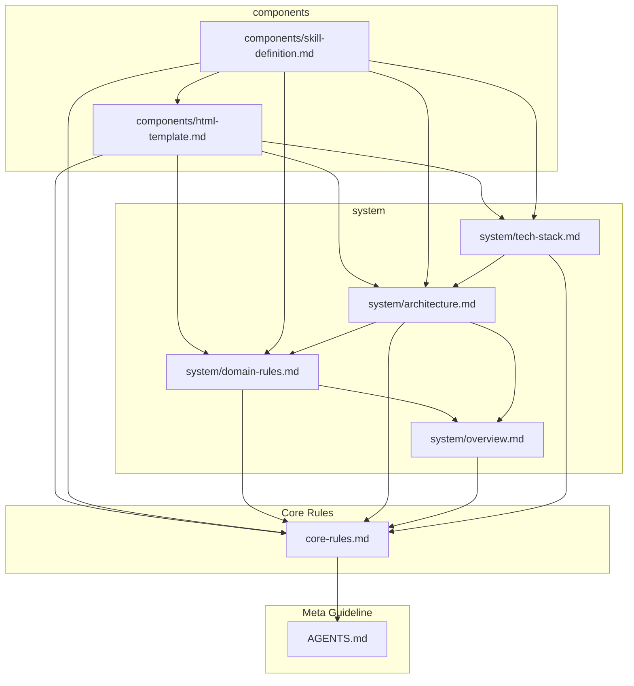

# 仕様書ルーティングマップ

<!-- @spec:spec-router -->

プロジェクト全体の仕様書インデックス正本（SSOT）。部分読込時は以下の主タグまたはセクションサブタグを `grep` して行番号を特定すること (**MUST**)。本ファイル内のダイアグラムおよびテーブルは、各仕様書の Frontmatter から完全自動生成されます。手動編集は行わないでください (**MUST NOT**)。

---

## 1. 仕様書依存ネットワークグラフ

<!-- @generated:spec-dag-start -->

<!-- @generated:spec-dag-end -->

---

## 2. 仕様書ルーティング ＆ サブタグ一覧

<!-- @spec:spec-routing-table -->

<!-- @generated:spec-table-start -->
| 分類 | 仕様書 | タイトル | 主タグ | セクションサブタグ | 対象スコープ | 依存仕様 |
| :---: | :--- | :--- | :--- | :--- | :--- | :--- |
| **0** | [AGENTS.md](../../AGENTS.md) | AI行動規範 | `@spec:agents-guideline` | `agent-context-retrieval`, `agent-four-layer-structure`, `agent-invincible-rules`, `agent-task-execution` | `AGENTS.md` | - |
| **-** | [spec-router.md](spec-router.md) | 仕様書ルーティングマップ | `@spec:spec-router` | `spec-routing-table` | `docs/specs/**/*.md` | `agents-guideline` |
| **1** | [core-rules.md](core-rules.md) | コア不可侵ルール | `@spec:core-rules` | `architecture-and-security-rules`, `lifecycle-and-test-rules` | `**/*` | `agents-guideline` |
| **components** | [components/_template.md](components/_template.md) | コンポーネント仕様書テンプレート | `@spec:component-template` | `component-template-contract`, `component-template-interface`, `component-template-schema`, `component-template-scope`, `component-template-verification` | `docs/specs/components/*.md` | `core-rules`, `domain-rules`, `system-architecture`, `tech-stack` |
| **components** | [components/html-template.md](components/html-template.md) | HTMLベーステンプレート ＆ インタラクティブビューア | `@spec:component-html-template` | `component-html-template-contract`, `component-html-template-interface`, `component-html-template-scope`, `component-html-template-verification` | `spec-to-readable-html/references/template.html` | `core-rules`, `domain-rules`, `system-architecture`, `tech-stack` |
| **components** | [components/skill-definition.md](components/skill-definition.md) | スキル定義 ＆ プロンプトプロトコル | `@spec:component-skill-definition` | `component-skill-definition-contract`, `component-skill-definition-interface`, `component-skill-definition-scope`, `component-skill-definition-verification` | `spec-to-readable-html/SKILL.md`, `spec-to-readable-html/references/html-output-template.md` | `core-rules`, `domain-rules`, `system-architecture`, `tech-stack`, `component-html-template` |
| **system** | [system/architecture.md](system/architecture.md) | システムアーキテクチャ ＆ コンポーネント構成 | `@spec:system-architecture` | `architecture-diagram`, `component-map`, `data-flow`, `usecase-map` | `**/*` | `core-rules`, `system-overview`, `domain-rules` |
| **system** | [system/domain-rules.md](system/domain-rules.md) | ドメイン用語 ＆ ドメイン不可侵ルール | `@spec:domain-rules` | `domain-glossary`, `domain-invariants` | `**/*` | `core-rules`, `system-overview` |
| **system** | [system/overview.md](system/overview.md) | システム概要 ＆ スコープ | `@spec:system-overview` | `system-purpose`, `system-scope` | `**/*` | `core-rules` |
| **system** | [system/tech-stack.md](system/tech-stack.md) | 技術スタック ＆ 開発検証環境 | `@spec:tech-stack` | `directory-structure`, `runtime-stack`, `verification-commands` | `**/*` | `core-rules`, `system-architecture` |
| **usecases** | [usecases/_template.md](usecases/_template.md) | ユースケース仕様書テンプレート | `@spec:usecase-template` | `usecase-template-overview`, `usecase-template-scenarios`, `usecase-template-schema`, `usecase-template-sequence`, `usecase-template-state`, `usecase-template-verification` | `docs/specs/usecases/*.md` | `core-rules`, `domain-rules`, `system-architecture`, `tech-stack` |
<!-- @generated:spec-table-end -->
