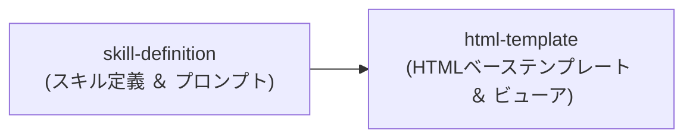

# システムアーキテクチャ ＆ コンポーネント構成

<!-- @spec:system-architecture -->

システム全体のコンポーネント分割、単方向依存グラフ、および外部入出力データフローの定義正本。

---

## 1. コンポーネント単方向依存グラフ

<!-- @spec:architecture-diagram -->

---

## 2. コンポーネント責務 ＆ 仕様書マッピング

<!-- @spec:component-map -->

本表の各行は `docs/components/<id>.md` の個別仕様書と **1対1（全単射）** で対応する (**MUST**)。

| コンポーネントID | 個別仕様書 | 対象コードパス (`target_files`) | 単一責務の定義 | 依存先コンポーネント |
| :--- | :--- | :--- | :--- | :--- |
| `skill-definition` | [skill-definition.md](../components/skill-definition.md) | `spec-to-readable-html/SKILL.md` `spec-to-readable-html/references/html-output-template.md` | 仕様書の構文解析・要約・構造再編・トレーサビリティ管理およびセクション生成プロトコルの提供 | `html-template` |
| `html-template` | [html-template.md](../components/html-template.md) | `spec-to-readable-html/references/template.html` | デザイントークン・レスポンシブCSS・図拡大モーダルおよびパン/ズーム等の表示基盤の提供 | - |

---

## 3. 外部境界 ＆ データフロー契約

<!-- @spec:data-flow -->

| 境界区分 | プロトコル / 形式 | 入出力対象・永続化ストア | バリデーション・変換契約 (`MUST`) |
| :--- | :--- | :--- | :--- |
| **外部入力** | CLI / Slash Command (`/spec-to-readable-html [lang]`) | Markdownファイル、プレーンテキスト仕様書、言語引数 | 入力仕様の言語判定（既定: `ja`）、文字コード UTF-8 検証 (`MUST`) |
| **コア処理** | Agent Skill 推論プロトコル | コンテキスト内テキスト、要約・図解選定ルール | RFC 2119キーワード保持、未確証事項のバッジ分類、HTML安全エスケープ (`MUST`) |
| **外部出力・永続化** | ポータブル HTML / ファイル出力 | ローカルファイルシステム（`*.html`, `*.spec.html`） | 埋め込みCSS適用、完全自己完結性（Mermaid CDN依存の注記またはSVG置換）の確保 (`MUST`) |
