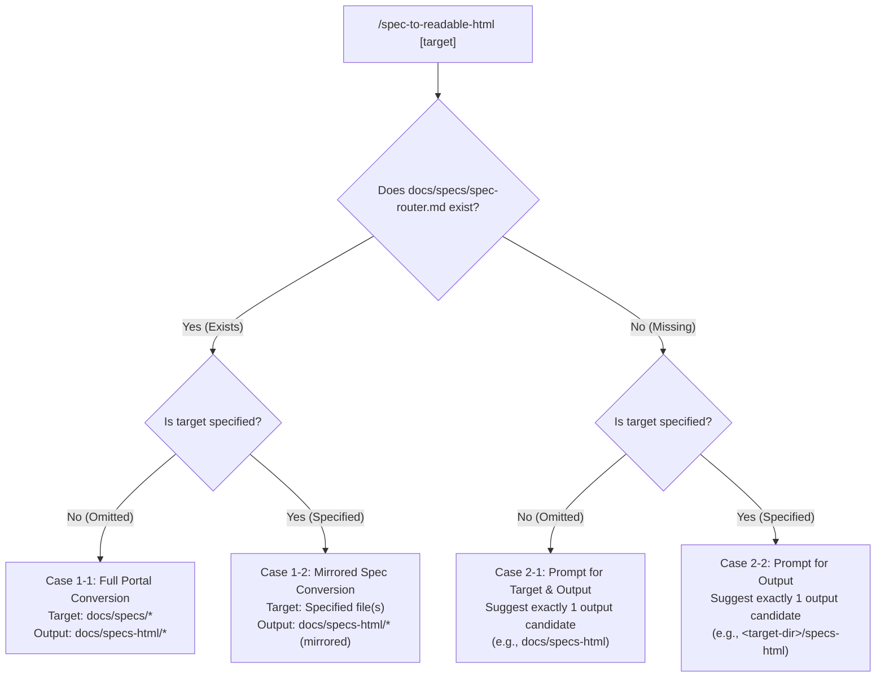

# Spec to Readable HTML

This skill transforms formal, dense, and structured specifications (Markdown or plain text) into visually engaging, human-readable HTML documents optimized for quick comprehension, decision-making, and alignment.

It operates as the **Human Read-Only View** in a 4-layer CQRS specification architecture (e.g., [nebula121/AIDD_Template](https://github.com/nebula121/AIDD_Template)). It does **not** perform literal Markdown-to-HTML conversion or lossy superficial summarization. Instead, it systematically applies **Cognitive Unpacking** to reveal the *intent*, *value*, and *concrete reality* behind abstract rules and schemas.

When invoked:
- `$target` sets the target specification file, directory, or scope (default: `docs/specs`).
- `$lang` sets the output language (default: `ja`). If omitted, Japanese is used.

---

## Operating Modes & Routing Protocol

Before generating HTML, inspect the environment and arguments to resolve the execution protocol across 4 cases:



### 1. Case 1-1: Full Portal Mode (Target Unspecified + `docs/specs/spec-router.md` Exists)
- **Condition**: `$target` is omitted or empty, and `docs/specs/spec-router.md` exists.
- **Target**: All specification files under `docs/specs/*`.
- **Output Structure**:
  - `docs/specs-html/index.html` (Portal page: Hero, dependency DAG network diagram, role-based reading routes, specifications catalog table).
  - `docs/specs-html/<relative-path-to-spec>.html` (Individual specification pages mirroring the source hierarchy under `docs/specs/`).
- **Navigation Contract**:
  - Every generated page MUST include the shared top navigation bar (`.global-nav`) and breadcrumbs bar (`.breadcrumbs`).
  - `.global-nav` maintains a sticky 52px single-row height: desktop uses hierarchical hover dropdowns (`.nav-dropdown`), while mobile (<=768px) collapses to a 52px bar with a hamburger toggle (`.nav-mobile-btn`) expanding an accordion menu (`.nav-mobile-collapse`).
  - `.breadcrumbs` immediately follows `.global-nav` to indicate portal hierarchy and current document name.

### 2. Case 1-2: Mirrored Spec Mode (Target Specified + `docs/specs/spec-router.md` Exists)
- **Condition**: `$target` is explicitly specified (e.g., `docs/specs/system/overview.md`), and `docs/specs/spec-router.md` exists.
- **Target**: Specified specification file(s).
- **Output Structure**:
  - Mirrored under `docs/specs-html/` maintaining the same relative hierarchy (e.g., `docs/specs-html/system/overview.html`).
  - Contains `.global-nav` with relative links to portal index (`../index.html`) and peer specifications.

### 3. Case 2-1: Interactive Prompt for Target & Output (Target Unspecified + Router Missing)
- **Condition**: `$target` is omitted, and `docs/specs/spec-router.md` does NOT exist.
- **Action**: Halt autonomous generation. Prompt user to provide both the target specification file/directory and the desired output directory.
- **Recommendation Rule**: Propose **exactly one** default output candidate (e.g., `docs/specs-html`).
- **Safety Guarantee**: MUST NOT guess or write files without explicit user specification.

### 4. Case 2-2: Interactive Prompt for Output (Target Specified + Router Missing)
- **Condition**: `$target` is specified, but `docs/specs/spec-router.md` does NOT exist.
- **Action**: Target is known, but standard output destination is undefined. Prompt user to specify the output directory.
- **Recommendation Rule**: Propose **exactly one** default output candidate (e.g., `<target-dir>/specs-html` or `docs/specs-html`).
- **Safety Guarantee**: MUST NOT write to an arbitrary directory before obtaining user confirmation.

---

## Core Protocol: Cognitive Unpacking

Structured tables and RFC 2119 keywords (`MUST`, `MUST NOT`, `SHOULD`) are efficient for verification tools and AI parsers, but impose high cognitive load on human readers. When encountering formal contracts, tables, and rules, **unpack** them into human-friendly cognitive representations:

### 1. Key Takeaways (`.key-takeaway`) — Mandatory
- Always place a 3-bullet summary box immediately after the header/TOC.
- Summarize: (1) Core purpose/scope, (2) Most critical constraint or guarantee, (3) Key stakeholder outcome.

### 2. Visual Completeness (Mandatory Diagram) — Mandatory
- **Every specification page MUST contain at least one Mermaid diagram** (or inline SVG).
- Choose the diagram type that clarifies the core cognitive bottleneck:
  - System topology / Component relationships: `flowchart TD` or `graph TD`
  - Lifecycle / State transitions: `stateDiagram-v2`
  - Sequence / Protocol exchanges: `sequenceDiagram`
  - Data models / Entities: `erDiagram`
  - Multi-layer defense / Security boundaries: `flowchart LR` / `flowchart TD` with subgraphs
- Wrap diagrams in `<figure class="diagram-container"><div class="diagram-badge">🔍 拡大表示</div><div class="mermaid">...</div><figcaption>Caption</figcaption></figure>`.
- Diagrams are constrained to `max-height: 520px` to prevent excessive scroll jumping. In line with the Ponytail principle, do NOT add gratuitous bounce, hover animations, or blinking effects to the badge.
- Use the base template's pan & zoom lightbox (click or `Enter`/`Space` to inspect complex diagrams).

### 3. Why & Before/After Comparison (`.comparison-grid`) — Mandatory
- Contrast the state **without** this specification against the state **with** it:
  - `.comparison-card--before`: Risks, ambiguities, vulnerabilities, or team friction absent this constraint.
  - `.comparison-card--after`: Guarantees, consistency, developer autonomy, and stability achieved with this specification.

### 4. Concrete Scenario Trace (`.scenario-box`) — Mandatory
- Anchor abstract types, APIs, or schemas with concrete, step-by-step example data.
- Clearly annotate non-normative or deduced examples with the `[Inferred]` or `[Example]` status badge.
- Number each step (`.scenario-step-num`) and show input/output payloads or execution effects.

### 5. Responsive Tables (`.table-responsive`) ＆ Sticky Columns (`.table-sticky-col`) — Mandatory
- Every structured table (`.spec-table` or standard `table`) MUST be wrapped in `<div class="table-responsive">...</div>` to enable clean horizontal scrolling on narrow viewports with a sticky header and scroll hint gradient shadow.
- When fixing the first column (e.g. symbol or API name), add `.table-sticky-col` to `.spec-table`. The first column is guarded with `max-width: 180px` and text-wrapping to prevent obscuring subsequent columns, and automatically falls back to static on narrow viewports (<=640px).

---

## Individual Specification Layout Standard

Follow this cognitive sequence for individual specification HTML documents:

```
1. Global Navigation (`.global-nav`: 4-layer dropdowns + mobile accordion)
2. Breadcrumbs Bar (`.breadcrumbs`: Relative path and current document)
3. Document Header (`.doc-header`: Title, Subtitle, Uniform `.doc-meta` pills + status color badge + navigation links)
4. TOC Sidebar (`.toc`: Sticky on desktop, `<details class="toc-details">` mobile accordion with auto-close on link tap, restricted to H2/H3)
5. Key Takeaways (`.key-takeaway`: 3-bullet core summary)
6. Visual Architecture / Workflow (Mandatory Mermaid Diagram)
7. Why & Before/After Comparison (`.comparison-grid`: Before vs. After)
8. Public Interfaces & Contracts (`.table-responsive` > `.spec-table`)
9. Concrete Scenario Trace (`.scenario-box`: Step-by-step example)
10. Acceptance Criteria & Edge Cases (Tables with badges / Risk cards)
11. Source Traceability & Appendix (Mapping back to original Markdown / RFC tags)
12. Footer (`.doc-footer`: Generation metadata & copyright)
```

---

## Portal Page (`index.html`) Layout Standard

When in Portal Mode, generate `docs/specs-html/index.html` with this structure:

```
1. Global Navigation (`.global-nav` with Home marked `.active`)
2. Hero Section (System Title, Architecture Vision, Last Updated, Status)
3. Architecture & Dependency Network (Interactive Mermaid DAG from spec-router.md)
4. Reading Paths by Role (`.reading-paths-grid` > `.reading-path-card`: e.g., Onboarding, Core Dev, Reviewer, Ops)
5. Specification Catalog (`.table-responsive` > `.spec-table` listing Layer, Title, Scope, Status, and Links)
6. System-wide Invariants & Core Constraints Summary
7. Footer
```

---

## Badges & Status Annotations

Maintain strict semantic distinctions using badges:

| Category | Class | Usage |
| :--- | :--- | :--- |
| **Requirement** | `.badge-must` / `.badge-should` / `.badge-could` / `.badge-wont` | RFC 2119 normative constraints |
| **Epistemic Status** | `.badge-confirmed` | Verified directly from source specification |
| | `.badge-inferred` / `.badge-assumption` | Deduced by AI / scenario examples (MUST NOT present as confirmed) |
| | `.badge-open` | Unresolved questions, missing decisions |
| **Risk / Severity** | `.badge-risk-high` / `.badge-risk-medium` / `.badge-risk-low` | Risk assessments and security impact |
| **Document Status** | `.badge-status-stable` (Green) / `.badge-status-draft` (Orange) / `.badge-status-deprecated` (Red) | Document lifecycle states in `.doc-meta` |
| **GitHub Alerts** | `.callout-note` (Blue), `.callout-tip` (Green), `.callout-important` (Purple), `.callout-warning` (Orange), `.callout-caution` (Red) | Callouts paired with 16x16 Octicons SVG icons |

---

## Security & Safety Guardrails

- **XSS Prevention**: Always escape user/source strings (`&amp;`, `&lt;`, `&gt;`, `&quot;`, `&#39;`). Never inject unsanitized HTML into content placeholders.
- **Traceability**: Never alter or drop normative RFC 2119 keywords or identifier names. Maintain explicit mapping to original `@spec:` tags or file headings in the traceability appendix.
- **Domain Neutrality**: Do not hardcode domain-specific concepts (e.g., medical, financial, specific app models) into this skill definition or templates. Keep all prompts, examples, and styles completely project-agnostic.

---

## Pre-Delivery Quality Checklist

Before finalizing any generated HTML document, verify:

- [ ] **Mode & Routing**: Correctly evaluated across Cases 1-1, 1-2, 2-1, or 2-2.
- [ ] **Navigation**: `.global-nav` (layer dropdowns & mobile accordion) and `.breadcrumbs` are present, correctly categorized, and highlight the current document as `.active`.
- [ ] **Key Takeaways**: `.key-takeaway` provides a clear 3-bullet executive summary at the top.
- [ ] **Visual Completeness**: Every page has at least one valid Mermaid diagram enclosed in `<figure class="diagram-container">`.
- [ ] **Before/After**: `.comparison-grid` clearly contrasts risks without the spec vs. value with it.
- [ ] **Scenario**: `.scenario-box` traces an end-to-end example with `[Inferred]` / `[Example]` badges.
- [ ] **Table Responsiveness**: Every table is wrapped in `.table-responsive` with sticky header, and wide tables use `.table-sticky-col` with the 180px guard.
- [ ] **Mobile TOC**: TOC uses `<details class="toc-details">` and auto-closes on anchor click.
- [ ] **Callouts & Alerts**: GitHub Alerts 5 classes (`.callout-note/tip/important/warning/caution`) use official 16x16 Octicons SVG icons.
- [ ] **Diagrams**: All diagrams feature the static badge without distracting animations.
- [ ] **Integrity**: Mermaid syntax parses without syntax errors; Pan & Zoom modal functions properly.
